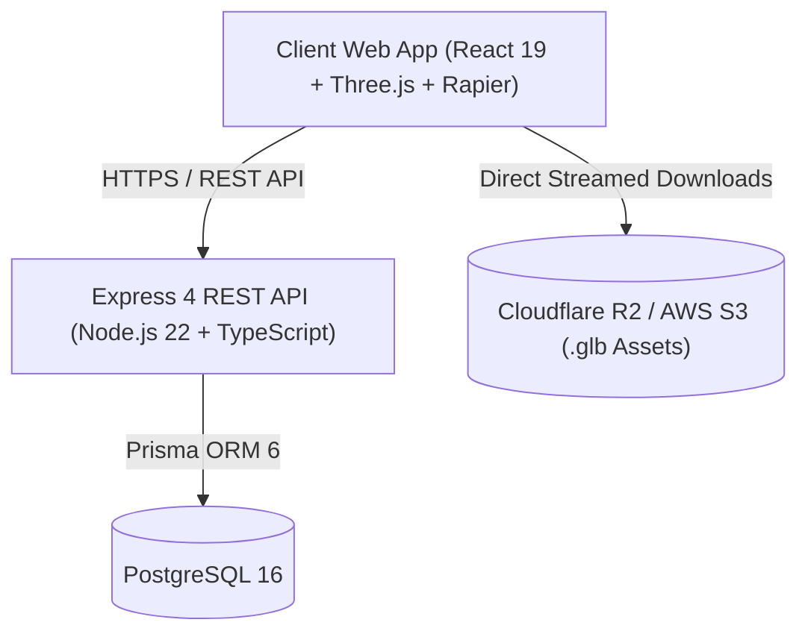

# MorphDrive — Real-Time 3D Vehicle Morphing & Driving Experience

**MorphDrive** is an interactive 3D web configurator and physics-driven driving simulation where modular cyber-vehicles dynamically transform between distinct operational modes:
- **Street Racer Mode**: Low aerodynamic ride height, maximum lateral downforce, and stiff suspension for high-speed tarmac cornering.
- **Off-Road Mode**: Elevated hydraulic ground clearance, widebody stance, and compliant damping for rough terrain traversal.
- **Flight Mode**: Deployable lateral glider wings, aerodynamic canards, and dual rear jet thrusters for high-velocity aerial glides.

---

## Architecture Overview



### Monorepo Structure

- **`apps/web`**: React 19 + TypeScript + Vite SPA utilizing **React Three Fiber (Three.js)**, **@react-three/drei**, **@react-three/rapier** 3D physics, **Zustand** state stores, and **Tailwind CSS**.
- **`apps/api`**: Express 4 + TypeScript REST API with **Prisma 6**, PostgreSQL, JWT authentication (HttpOnly cookies + Bearer tokens), Argon2 password hashing, and S3-compatible asset management service.
- **`packages/shared`**: Shared Zod schemas, TypeScript contracts, telemetry definitions, vehicle base presets (`Spectre RS`, `Apex Nomad`, `Valkyrie Aero`), and physics tuning constants.

---

## Quickstart & Development

### 1. Install Dependencies
```bash
pnpm install
```

### 2. Launch Local Database & Services (Docker Compose)
```bash
docker compose up -d
```
*Spins up PostgreSQL 16 on port `5432` and MinIO S3 sandbox on ports `9000` / `9001`.*

### 3. Initialize & Seed Database
```bash
# Generate Prisma Client
pnpm db:generate

# Apply Migrations
pnpm db:migrate

# Seed Vehicle Archetypes & Tracks
pnpm db:seed
```

### 4. Start Development Servers

To run both the Frontend and API in parallel:
```bash
pnpm dev
```

Or run individual services:
```bash
# Frontend (http://localhost:5173)
pnpm dev:web

# Backend API (http://localhost:4000)
pnpm dev:api
```

---

## Build & Test Verification

```bash
# Build shared package, API, and Web distribution bundles
pnpm build

# Run TypeScript typechecks across the monorepo
pnpm lint
```
